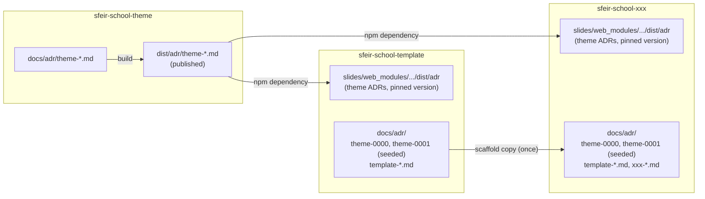
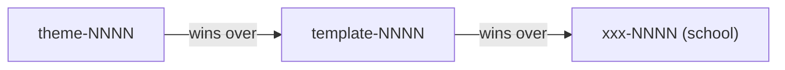

# theme-0000. Adopt Architecture Decision Records (ADRs)

### Submitters

- Jean-François Garreau (SFEIR)

## Change Log

- [pending](https://github.com/sfeir-open-source/sfeir-school-theme/pull/159) 2026-09-23
- [amended](https://github.com/sfeir-open-source/sfeir-school-theme/pull/159) 2026-10-14 — tier prefix on every ADR file (`theme-`, `template-`, `<xxx>-`), precedence rule rewritten, seeded ADRs copied as-is

## Referenced Use Case(s)

No formal use-case document exists. This ADR is self-motivating — see
Context below.

## Context

`sfeir-school-theme` sits at the bottom of a three-tier chain:

- **`sfeir-school-theme`** — the RevealJS theme, published to npm. `dist/`
  is its public contract.
- **`sfeir-school-template`** — a scaffold that depends on the theme and
  adds the training structure (`slides/`, `labs/`).
- **`sfeir-school-xxx`** — one repository per concrete training, generated
  from the template.

A decision made in the theme (a breaking API, a naming convention, a
build-tooling choice) affects the template, then every generated `xxx`
instance. Today nothing is written down:

- contributors have no way to know *why* something is the way it is;
- the same trade-off gets re-argued at each tier;
- the contributor base rotates, so an undocumented decision is lost the
  moment its author moves on.



Out of scope for this ADR: how a school (the `xxx` in `sfeir-school-xxx`)
gets named. That deserves its own ADR.

## Proposed Design

### 1. File naming: the prefix is the tier

Every ADR file carries the prefix of the tier that owns the decision:

| Tier | File name | Sequence |
|---|---|---|
| theme | `theme-NNNN-kebab-slug.md` | its own, from `0000` |
| template | `template-NNNN-kebab-slug.md` | its own, from `0000` |
| school `sfeir-school-xxx` | `<xxx>-NNNN-kebab-slug.md` | its own, from `0000` |

- `NNNN` is zero-padded, sequential within its tier, never reused.
- There is no bare-numbered file at any tier, this repo included.
- A new file exists only for a new decision. A release or a git tag is
  never by itself a reason to create a file. Once a decision ships, that
  fact is one more Change Log line on its existing file, e.g.:

```
- [approved](<PR URL>) 2026-10-01 — shipped in v4.1.0
```

### 2. Propagation, and the compliance rule

- The theme publishes `docs/adr/` as `dist/adr/`.
- The template and every `xxx` instance consume it as an npm dependency,
  exactly like the theme's compiled CSS/JS.
- The deck's `prepare` script already copies the whole installed package
  into `slides/web_modules/sfeir-school-theme/` on `npm install`
  ([[theme-0004-self-contained-slides]]), so the theme ADRs land in
  `slides/web_modules/sfeir-school-theme/dist/adr` with no extra step.

**Rule: the template, and every instance generated from it, must comply
with every ADR published by the theme version it depends on.** Bumping that
dependency is what brings new or changed theme ADRs down the chain.

Two theme ADRs are also seeded into each downstream `docs/adr/`, so the
obligation is visible locally:

- [[theme-0000-adopt-adrs]] (this ADR);
- [[theme-0001-comply-with-theme-adrs]] (the compliance rule).

`sfeir-school-theme-migrate` copies them **as-is**: same file name, same
content, no renumbering. They keep their `theme-` prefix because they are
theme decisions.

### 3. Order of precedence: theme > template > school

The prefix tells which tier a decision belongs to, and therefore how it
ranks when two ADRs touch the same subject:



- A `theme-` ADR wins over any `template-` or `<xxx>-` ADR on the same
  subject.
- A `template-` ADR wins over any `<xxx>-` ADR on the same subject.
- A lower tier may only add decisions on subjects the tiers above leave
  open. It never overrides them, and writing its own ADR does not opt it
  out of a higher-tier one.
- A lower-tier ADR that conflicts with a higher-tier one is void on the
  conflicting point. Its owner amends it (a Change Log line), never the
  higher tier.
- A higher-tier ADR may itself leave a choice open to the lower tiers.
  Making that choice downstream applies the higher-tier ADR, it does not
  override it.
- Theme ADRs reach a project through its npm dependency, so a version bump
  updates them. Template ADRs reach a school only through the scaffold
  copy: there is no update channel, and a school picks up later template
  ADRs by copying them by hand.

## Considerations

- **A file per theme release vs. one sequence per tier.** Dropped: a
  release isn't a decision, and the Change Log already records which
  release shipped a decision.
- **A filesystem symlink vs. dependency consumption.** A literal symlink
  only works when theme, template and instances sit in the same workspace,
  which they don't across an `npm install` boundary. Downstream tiers read
  the theme's *published* ADRs (`dist/adr`), never the raw `docs/adr`
  sources.
- **A special `custoADR.md` file vs. a prefixed convention.** The point was
  never a dedicated file name, just that every school is free to add ADRs.
  The `<xxx>-` prefix does that, and also tells the reader the decision's
  tier, hence its precedence, at a glance.
- **Bare numbers in the theme repo, prefixes only downstream.** Rejected:
  two conventions for one practice, and a seeded theme ADR would need
  renumbering to fit a project's own sequence, which breaks its identity
  and its cross-references. Prefixing everywhere removes both problems.

## Decision

- ADRs are adopted at all three tiers, using the edgex template, with the
  Change Log as the sole revision mechanism: a decision is edited in place,
  never superseded by a new file.
- Every ADR file is named `<tier>-NNNN-kebab-slug.md` (`theme-`,
  `template-` or `<xxx>-`), each tier with its own sequence from `0000`. A
  release never creates a file by itself (point 1).
- The theme publishes `dist/adr/`; the template and every instance consume
  it through the existing npm dependency, read under
  `slides/web_modules/sfeir-school-theme/dist/adr`, and **must comply**
  with the ADRs of the theme version they depend on (point 2).
- `sfeir-school-theme-migrate` seeds [[theme-0000-adopt-adrs]] and
  [[theme-0001-comply-with-theme-adrs]] into a project's `docs/adr/` as-is,
  without renumbering (point 2).
- Precedence follows the prefix: theme > template > school. A lower tier
  only decides what the tiers above leave open (point 3).
- Out of scope, tracked as follow-up work:
  - the naming convention for a school (the `xxx` in `sfeir-school-xxx`),
    its own future ADR;
  - tooling to detect duplicate or out-of-order numbers, not needed at the
    current scale.

## Other Related ADRs

- [[theme-0001-comply-with-theme-adrs]] - the compliance rule, seeded with
  this ADR
- [[theme-0016-minimal-tooling-footprint]] - last ADR of the first series
  built on these conventions

## References

- [Architecture Decision Record template by edgex](https://github.com/architecture-decision-record/architecture-decision-record/blob/38ae60b13ed9725ee3e350431a7ad49228539bd9/locales/en/templates/decision-record-template-by-edgex/index.md)
- [`scripts/prepare-publish.ts`](https://github.com/sfeir-open-source/sfeir-school-theme/blob/main/scripts/prepare-publish.ts) - publishes `docs/adr` as `dist/adr`
- [`scripts/sfeir-school-theme-migration.ts`](https://github.com/sfeir-open-source/sfeir-school-theme/blob/main/scripts/sfeir-school-theme-migration.ts) - seeds the two founding ADRs
