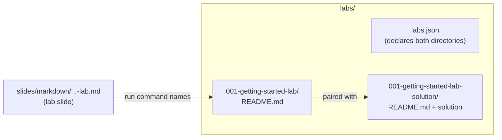

# theme-0006. Lab contract: directories, instructions, solution, declaration, slide

### Submitters

- Jean-François Garreau (SFEIR)

## Change Log

- [pending](https://github.com/sfeir-open-source/sfeir-school-theme/pull/159) 2026-09-23
- [amended](https://github.com/sfeir-open-source/sfeir-school-theme/pull/159) 2026-10-14 — became the single lab contract (absorbs [[theme-0010-lab-instructions-contract]] and [[theme-0011-lab-solution-pairing]]); mandatory `NNN-name-lab` naming; `.nosolution`; `labs.json`; lab slide detected by path

## Referenced Use Case(s)

No formal use-case document exists. This ADR is self-motivating — see
Context below.

## Context

A lab is a hands-on exercise of a training. Its rules used to be spread
over four ADRs (slide format, naming, instructions, solution), so a reader
had to assemble one concept from four files. This ADR is the single place
that says what a lab is. How labs are declared as npm workspaces stays in
[[theme-0009-labs-as-npm-workspaces]].

## Proposed Design



### 1. Labs are optional

A training may have no lab at all. That is legitimate: it then needs no
`labs/` directory and no lab slide ([[theme-0009-labs-as-npm-workspaces]]).

### 2. Directory naming

Each lab is a pair of directories under `labs/`:

| Directory | Name | Example |
|---|---|---|
| exercise | `NNN-name-lab` | `001-getting-started-lab` |
| solution | `NNN-name-lab-solution` | `001-getting-started-lab-solution` |

- `NNN` is exactly three digits and gives the order of the labs.
- `name` is kebab-case.
- The naming is mandatory and enforced by the `L_011` `check` rule.
  Directories listed in `ignoreLabsDirectories` (technical, non-exercise
  directories) are exempt.

### 3. Exercise instructions

The exercise directory holds a `README.md` that tells the learner what to
do:

- the exercise itself, and hints;
- a title of the exact form `# <lab> instructions` (`L_006`), where
  `<lab>` is the directory name;
- the command that runs the lab, `<labCommandPrefix><lab>`, when the
  project sets `labCommandPrefix` (`L_007`).

The README must exist and be non-empty (`L_005`).

### 4. Solution, or `.nosolution`

- Every exercise directory has its `-solution` directory (`L_008`), and
  every `-solution` directory matches an exercise (`L_009`).
- When the solution directory has a `README.md`, it is identical to the
  exercise's one (`L_010`).
- A lab for which a solution makes no sense (open-ended exercise,
  exploration) opts out with a `.nosolution` file **inside the exercise
  directory**: `labs/<lab>/.nosolution`. Its content is ignored.
  - With `.nosolution`, the lab must **not** have a `-solution` directory
    (`L_008` fails if both exist).
  - Every other rule still applies: naming, README, declaration, slide.

### 5. Declaration in `labs.json`

Every exercise and solution directory is declared (`L_002`). Without npm
workspaces, the declaration is `labs/labs.json`, one `labs` array naming
the directories:

```json
{
    "labs": ["001-getting-started-lab", "001-getting-started-lab-solution"]
}
```

The npm workspaces alternative (`labs/package.json`) is defined in
[[theme-0009-labs-as-npm-workspaces]].

### 6. Lab slide

A lab is announced on the deck by a lab slide:

- **Detection is by path.** A slide declared in `formation()` is a lab
  slide when its path contains `-lab-` or `-lab.md`. Only those slides get
  the checks below.
- The slide holds the exact line `<!-- .slide: class="exercice" -->` (the
  visual convention for a lab, no other class on that line) and a `## Lab`
  line (`S_006`).
- It has a `# <title>`, one or two sentences on what the learner builds or
  fixes (the step-by-step stays in the README), and the run command.

```
<!-- .slide: class="exercice" -->

# Run a test suite

## Lab

One or two sentences: the "what" and "why", not the step-by-step.

<labCommandPrefix><lab>
```

- The run command is checked only when the project sets
  `labCommandPrefix`. With an empty prefix, `S_005` does not check anything
  useful. With a prefix:
  - the slide contains the run command, and that command names a declared
    lab (`S_005`);
  - that lab has its directory in `labs/` (`S_011`).
- Every declared exercise is named, prefix included, by at least one slide
  of `formation()` (`L_001`). `L_001` reads every declared slide, not only
  lab slides.
- A lab with no command to run (browser-only, manual) lists its slide in
  `ignoreCommandCheck` to skip `S_005`/`S_011`.

## Considerations

- **Keep four ADRs (slide, naming, instructions, solution).** Rejected:
  one concept split over four files is hard to follow.
  [[theme-0010-lab-instructions-contract]] and
  [[theme-0011-lab-solution-pairing]] are deprecated in favour of this one.
- **Naming as a recommendation only.** Rejected: an unenforced convention
  drifts across schools. Cost: existing schools whose labs use another
  shape (the template's `01-workshop-example`) rename them once, by hand:
  `sfeir-school-theme-migrate` does not rename labs. `labs.json`, the
  slides' run commands and any package script naming a lab follow the
  rename.
- **Opt out of a solution through a config list.** Rejected: a marker file
  lives next to the lab it describes and travels with it on copy or rename.
- **A lighter slide marker (e.g. front-matter).** Rejected: changing the
  marker is a separate concern from formalizing the existing convention.

## Decision

- A training may have zero labs.
- A lab is the directory pair `labs/NNN-name-lab/` +
  `labs/NNN-name-lab-solution/`; the naming is mandatory and enforced by
  `L_011`.
- The exercise `README.md` holds the exercise and hints, titled
  `# <lab> instructions`, with the run command when `labCommandPrefix` is
  set.
- The solution directory is mandatory, unless the exercise holds a
  `.nosolution` file; then a solution directory is forbidden.
- Every lab and solution directory is declared in `labs/labs.json` (or as
  npm workspaces, [[theme-0009-labs-as-npm-workspaces]]).
- A lab is announced by a slide whose path contains `-lab-` or `-lab.md`,
  using the exact `exercice` slide line, `## Lab` and the run
  command; every lab is named by at least one declared slide.

## Other Related ADRs

- [[theme-0003-labs-directory]] - `labs/` and the `lab` vocabulary
- [[theme-0005-slide-declaration-contract]] - lab slides are a subset of declared slides
- [[theme-0009-labs-as-npm-workspaces]] - npm workspaces declaration, and the no-labs case
- [[theme-0010-lab-instructions-contract]] - deprecated, merged here
- [[theme-0011-lab-solution-pairing]] - deprecated, merged here
- [[theme-0012-bounded-config-overrides]] - `labCommandPrefix`, `ignoreLabsDirectories`, `ignoreCommandCheck`

## References

- [`cli/command/check/check-labs.ts`](../../cli/command/check/check-labs.ts) - `L_002`–`L_011`
- [`cli/command/check/check-slides.ts`](../../cli/command/check/check-slides.ts) - `S_005`, `S_006`, `S_011`, `L_001`
- [`cli/utils/slide.utils.ts`](../../cli/utils/slide.utils.ts) - lab slide detection by file name
- [`cli/utils/labs.utils.ts`](../../cli/utils/labs.utils.ts) - `labs.json` / `package.json` reading, `.nosolution`
- [`cli/README.md`](../../cli/README.md)
